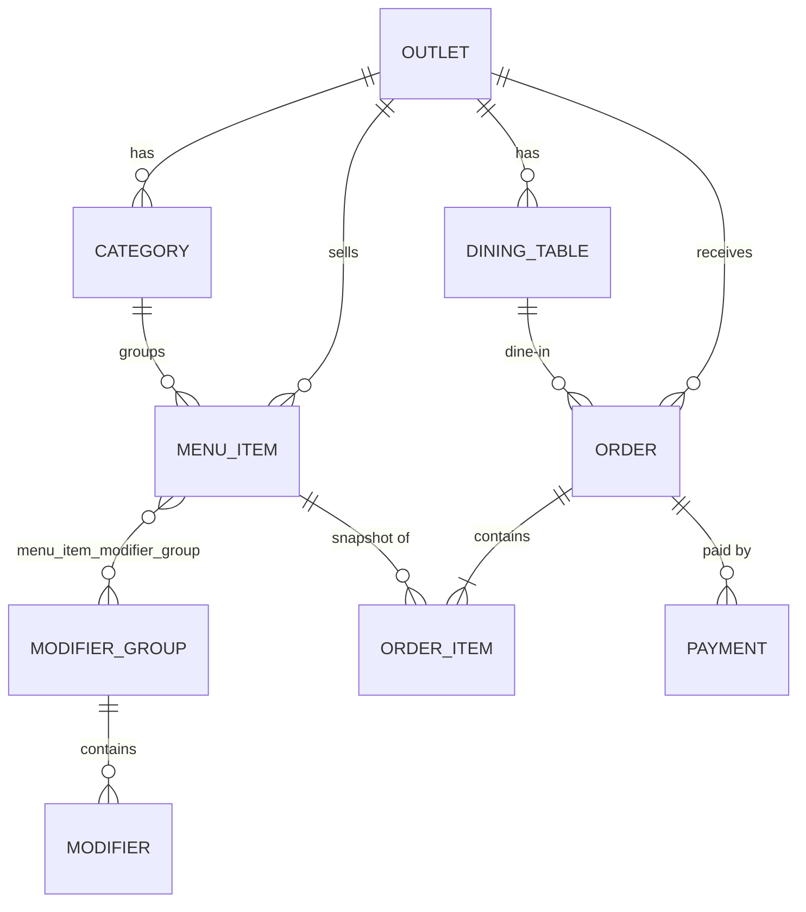
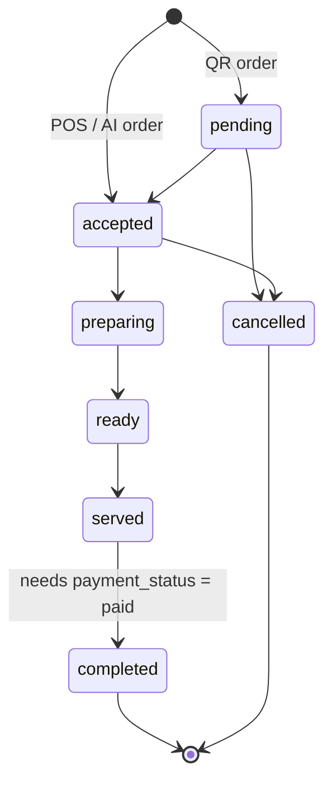

# FeedYou — System Architecture

A FeedYou restaurant POS for Malaysian F&B: counter POS, QR table ordering, kitchen display (KDS), owner dashboard, and an AI layer that turns Manglish orders into carts and sales data into tips.

## 1. What changed (before → after)

| Area | Before | After |
|---|---|---|
| Structure | 1 controller, 1 service, logic in routes | Layered modular monolith: Enums → Models → Services → thin Controllers → 4 front ends |
| Schema | `menu_items`, `orders` (items as a JSON blob, float prices), `settings` | 11 tables: outlets, categories, menu items, modifier groups/modifiers, tables (QR tokens), orders, order items (price snapshots), payments, settings |
| Money | `decimal(8,2)` | Integer **sen**, server-side pricing, 10% service charge (dine-in), 6% SST on subtotal + service, 5-sen rounding |
| Order flow | free-text `status` | Enforced state machine: pending → accepted → preparing → ready → served → completed (cancel allowed only before cooking) |
| AI | Gemini 1.5 call, key in URL query, hard-coded | `LlmClient` interface (provider-swappable), Gemini 2.5 Flash, key sent in a header and **encrypted at rest**, model output checked against the menu, offline rule-based fallback |
| Security | `/setup` open, API key shown in plain text | Staff PIN (hashed, rate-limited), staff API token, public endpoints limited to menu, QR ordering and order tracking |
| Bugs | `routes/web.php` had a syntax error (`function (GeminiService )`); Dockerfile used PHP 8.2 but deps need ≥ 8.4 | Fixed |
| Tests | Example only | 16 tests / 77 assertions: pricing, lifecycle, auth, encryption, AI parsing, every page renders |

## 2. System context

```mermaid
flowchart LR
    C[Customer phone<br/>scans table QR] -->|/t/{token}| W
    S[Cashier tablet<br/>POS] --> W
    K[Kitchen screen<br/>KDS] --> W
    O[Owner<br/>Dashboard / Setup] --> W
    subgraph W[Laravel 13 app]
      UI[Blade + vanilla JS front ends] --> API[/REST API v1/]
      API --> SVC[Domain services]
      SVC --> DB[(SQLite / MySQL / Postgres)]
      SVC --> AI[AI layer]
    end
    AI -->|optional| G[Gemini API]
```

## 3. Layers & folders

```
app/
├─ Enums/                 OrderStatus (state machine), OrderChannel, OrderType, PaymentMethod, PaymentStatus
├─ Models/                Outlet, Category, MenuItem, ModifierGroup, Modifier, DiningTable, Order, OrderItem, Payment, Setting
├─ Services/
│  ├─ Ordering/           PriceCalculator (pure pricing), OrderService (the ONLY write path for orders)
│  ├─ AI/                 Contracts/LlmClient, GeminiClient, OrderParser, RuleBasedOrderParser, InsightsService
│  ├─ Reports/            SalesReport (daily KPIs, top items, by hour, by channel)
│  └─ Settings/           SettingsStore (key/value, encrypts secrets)
├─ Events/                OrderPlaced, OrderStatusChanged   ← hook printers, notifications, broadcasting here
├─ Exceptions/            DomainException → HTTP 422 with a readable message
└─ Http/
   ├─ Controllers/Api/V1/ Menu, Order, Table, Ai, Report  (thin: validate → service → resource)
   ├─ Controllers/Web/    PageController (serves the screens), StaffSessionController (PIN)
   ├─ Middleware/         StaffAuth (session for pages, X-Staff-Token header for the API)
   ├─ Requests/           PlaceOrderRequest
   └─ Resources/          OrderResource
resources/views/          layouts/app, home, setup, staff/{login,pos,kitchen,admin}, customer/order
public/js/pos-common.js   shared API client, cart model, modifier picker, voice input
public/vendor/            Tailwind (browser build) + QR generator served locally, so the POS still works if the shop's internet drops
```

**Rule of thumb:** controllers never calculate money or change status directly. They call `OrderService`, which uses `PriceCalculator` and the `OrderStatus` rules. That keeps POS, QR, KDS and any future app (mobile, delivery platform) consistent.

## 4. Data model



- **Snapshots:** `order_items` copies name, unit price and modifiers at the time of sale, so later menu edits never change past receipts or reports.
- **Multi-outlet ready:** every business table has `outlet_id`. Today `Outlet::current()` returns the first outlet; switch to subdomain/header-based resolution when you add branches.
- **Money:** `*_sen` integers; tax and service charge in basis points (`600` = 6.00%).

## 5. Order lifecycle



Payments are separate from status: an order can be paid at any point (takeaway pays first, dine-in pays last). Paying a served order closes it automatically. Cash can be over-tendered (change is returned); other methods are capped at the balance; split payments give `partial`.

## 6. AI layer

```mermaid
sequenceDiagram
    participant U as Cashier / Customer
    participant P as OrderParser
    participant L as LlmClient (Gemini)
    participant R as RuleBasedOrderParser
    U->>P: "2 kopi o kurang manis, satu nasi lemak"
    alt API key configured
        P->>L: prompt + live menu (id, name, price, aliases), JSON mode
        L-->>P: {items:[{menu_item_id, quantity, notes}], unmatched}
        P->>P: drop ids not on the menu, clamp quantities
    else no key / call failed
        P->>R: fuzzy match on names + aliases, Malay numbers (satu, dua…), x3 / 3x, notes (kurang manis, tambah…)
    end
    P-->>U: proposed cart (NOT saved; the user confirms)
```

- **Grounded:** the model only ever picks from menu ids, and every id is checked again on the server.
- **Human in the loop:** parsing fills the cart; nothing is ordered until someone taps *Send*.
- **Provider-agnostic:** bind a different `LlmClient` in `AppServiceProvider` to switch to Claude, OpenAI or a local model.
- **Works offline:** with no key, the demo still parses Manglish through the rule-based parser.
- `InsightsService` turns `SalesReport` into 3 tips for the owner (LLM, or a rule-based fallback).

## 7. API (v1)

| Method | Path | Auth | Purpose |
|---|---|---|---|
| GET | `/api/v1/menu` | public | Categories, items, modifiers |
| POST | `/api/v1/orders/quote` | public | Price a cart without saving |
| POST | `/api/v1/orders` | public with `table_token` (QR), otherwise staff | Place order |
| GET | `/api/v1/orders/{order_no}/track?t=` | public (table token) | Customer order status |
| POST | `/api/v1/ai/parse-order` | public, throttled | Natural language → cart |
| GET | `/api/v1/orders?scope=kitchen\|open\|today` | staff | KDS / open bills |
| GET | `/api/v1/orders/{id}` | staff | Order detail |
| POST | `/api/v1/orders/{id}/status` | staff | Move order to the next status |
| POST | `/api/v1/orders/{id}/pay` | staff | Record a payment |
| GET | `/api/v1/tables` | staff | Tables, whether occupied, open totals, QR URLs |
| POST/PATCH | `/api/v1/menu/items[/{id}[/availability]]` | staff | Menu CRUD, mark sold out |
| GET | `/api/v1/reports/daily?date=` | staff | KPIs |
| GET | `/api/v1/ai/insights?date=` | staff | AI tips |

Errors: validation → 422 `{message, errors}`; business rule → 422 `{message}`; auth → 401.

## 8. Security model (hackathon level)

- **Staff PIN:** stored as a bcrypt hash, 5 tries per minute per IP. Until a PIN is set, staff screens stay open (first-run mode). `/setup` shows this clearly.
- **API:** stateless. Staff pages get an HMAC token (from `APP_KEY` + the PIN hash) in a `<meta>` tag and send it as `X-Staff-Token`. Changing the PIN revokes every issued API token.
- **Secrets:** the Gemini key is encrypted with `APP_KEY` and never shown in the form again.
- **Prices:** prices and totals are always worked out on the server. Prices sent by the client are ignored.
- **Not yet:** per-user accounts and roles, audit log. See roadmap.

## 9. Running it

```bash
composer install
cp .env.example .env && php artisan key:generate
touch database/database.sqlite
php artisan migrate:fresh --seed     # demo kopitiam menu + 8 QR tables
php artisan serve                    # http://localhost:8000
php artisan test
```

Docker: `docker compose up --build` (PHP 8.4; on first boot the entrypoint creates `.env`, the app key, the database and demo data).

Pages: `/` home · `/pos` · `/kitchen` · `/admin` · `/setup` · `/t/{qr_token}` (customer; links are on the Dashboard).

## 10. Roadmap (in priority order)

1. **Real-time:** use Laravel Reverb to broadcast `OrderPlaced` / `OrderStatusChanged` instead of polling every 5 s.
2. **Printing:** a listener on `OrderPlaced` → ESC/POS kitchen and receipt printers.
3. **Payments:** DuitNow QR / e-wallet gateway webhooks → `OrderService::pay`.
4. **Accounts & roles:** owner, cashier and kitchen roles (Laravel Sanctum) replacing the shared PIN; audit log.
5. **Multi-outlet:** resolve the outlet per request; central menu with per-outlet price overrides.
6. **Inventory:** recipe → ingredient deduction, low-stock alerts, AI demand forecast from `SalesReport`.
7. **AI upsell:** suggest add-ons at checkout from co-purchase data; voice ordering kiosk.
8. **e-Invoice (LHDN MyInvois)** integration for compliance.
